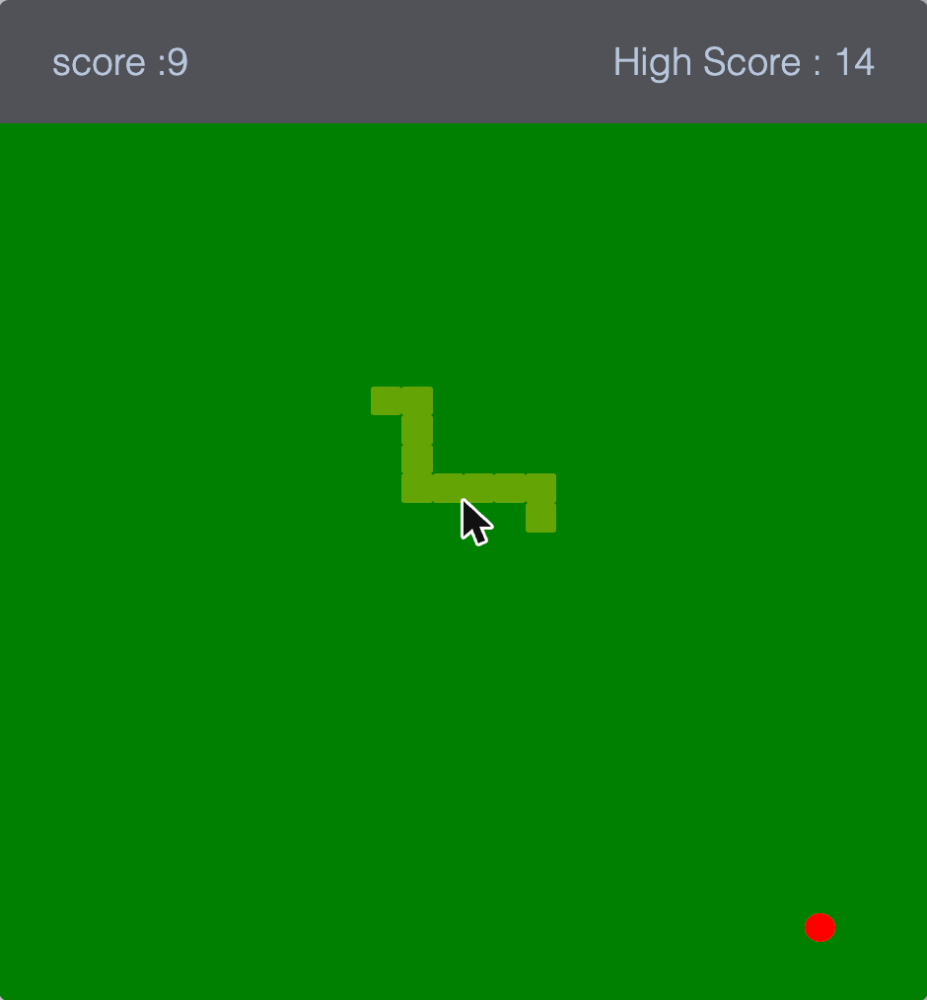

# 🐍 Juego de la Serpiente

Clon del clásico juego de la serpiente (Snake), construido desde cero con **HTML, CSS y JavaScript puro**, sin frameworks ni librerías externas.



## 🎮 Jugar

👉 **[Jugar en vivo](https://m4nuel-ceron.github.io/Game-Snake/)**

### Controles

- **Escritorio:** usa las flechas (`↑ ↓ ← →`) del teclado para mover la serpiente.
- **Móvil:** desliza el dedo sobre el tablero en la dirección deseada, o usa los botones táctiles en pantalla.
- Cuando pierdas, presiona **"Jugar de nuevo"** para reiniciar sin recargar la página.

## ✨ Características

- Movimiento de la serpiente sobre un tablero de 30x30 celdas.
- Generación aleatoria de comida.
- Puntaje en tiempo real y mejor puntaje (high score) guardado en `localStorage`.
- Pantalla de "Game Over" con el puntaje final y botón para reiniciar la partida.
- Soporte táctil completo: botones en pantalla y gestos de deslizamiento (swipe) para jugar desde el celular.

## 🛠️ Tecnologías

- HTML5
- CSS3 (`grid`, `flexbox`, animaciones básicas)
- JavaScript (vanilla, sin dependencias)

## 🚀 Cómo ejecutarlo localmente

No necesita instalación ni dependencias. Puedes abrir `index.html` directamente en el navegador, o levantar un servidor local:

```bash
git clone https://github.com/M4NUEL-CERON/Game-Snake.git
cd Game-Snake
python3 -m http.server 8080
```

Luego abre [http://localhost:8080](http://localhost:8080) en tu navegador.

## 📁 Estructura del proyecto

```
Game-Snake/
├── index.html          # Estructura de la página
├── css/
│   └── style.css       # Estilos del tablero, overlay y controles táctiles
├── js/
│   └── main.js          # Lógica del juego (bucle, movimiento, colisiones, puntaje)
└── screenshot.png       # Captura usada en este README
```

## 🙋 Autor

**Manuel Cerón** — [@M4NUEL-CERON](https://github.com/M4NUEL-CERON)

## 📄 Licencia

Este proyecto está bajo la licencia [MIT](LICENSE).
